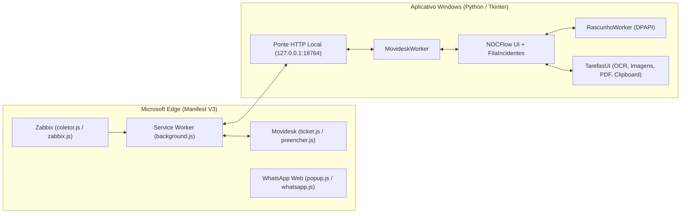

# Arquitetura Técnica — NOCFlow

Este documento apresenta de forma direta a arquitetura, a organização dos módulos, os contratos de dados e os mecanismos de segurança do **NOCFlow**.

- **Operação passo a passo:** [Manual de Uso](manual.md)
- **Visão geral do projeto:** [README](../README.md)
- **CI, dependências e publicação:** [Releases](releases.md)

---

## 1. Visão Geral

O NOCFlow combina um **aplicativo desktop Windows (Python 3.12 + Tkinter/TTK)** com uma **extensão Microsoft Edge (Manifest V3)**. O estado, o OCR, as regras e a persistência são 100% locais; a extensão atua apenas na leitura do DOM do Zabbix, preenchimento do formulário do Movidesk e assinatura no WhatsApp Web dentro da sessão já autenticada do operador.



### Princípios Arquiteturais
1. **Local primeiro:** importação via DOM/JSON, OCR nativo do Windows (`Windows.Media.Ocr`), fila, templates de comunicação, motor de regras e relatórios PDF/CSV funcionam offline e sem IA.
2. **Privacidade e Segurança por Padrão:**
   - Rascunhos (`.noc_data/rascunho.json`) e chaves de API (`.noc_data/credenciais.dpapi`) são criptografados em repouso com **Windows DPAPI** vinculado ao usuário do Windows, com retenção máxima de 30 dias de inatividade.
   - `ExclusividadeDados` garante instância única por diretório de dados e todas as gravações em disco são atômicas (`tempfile` + `flush` + `os.fsync` + `os.replace`).
   - URLs operacionais exigem **HTTPS**. A ponte local opera estritamente em loopback (`127.0.0.1:18764`) com validação de `Host`/`Origin` e tokens descartáveis de 43 caracteres comparados com `secrets.compare_digest`.
   - **Imagens nunca são enviadas para IA externa:** tanto Groq quanto Gemini recebem exclusivamente texto transcrito pelo OCR local, após redação automática de padrões sensíveis (credenciais, e-mails, IPs, CPFs, marcações confidenciais) em `politica_ia.py` e confirmação explícita do operador em janela de prévia (`IA_EXTERNA_APROVADA=true`).
3. **Interface Não-Bloqueante:** a thread principal gerencia apenas o Tkinter. Operações de I/O, imagens, clipboard e exportação rodam em `TarefasUI` (pool de até 4 workers), `MovideskWorker` e `RascunhoWorker`, comunicando resultados por filas processadas em fatias de até 15 ms.

---

## 2. Estrutura do Repositório

```text
app_noc.py                   Ponto de entrada do aplicativo e do smoke test (--verificar-build)
noc/
  interface.py               Controlador principal Tkinter e despacho de eventos
  atendimento.py             Etapas do incidente, pendências, severidades e próxima ação
  incidentes.py              Contrato de importação, deduplicação (instância, eventid) e fila
  comunicados.py             Validação, templates (WhatsApp/Teams/E-mail) e HTML com <br>
  movidesk.py                Worker de coordenação Zabbix/Movidesk e sessão de 10h
  edge_bridge.py             Servidor HTTP local seguro e preparação da extensão
  rascunhos.py               Worker de persistência atômica cifrada com DPAPI
  extracao.py                Pipeline OCR local -> Groq -> Gemini (somente texto redigido)
  extracao_local.py          Parser de rótulos PT/EN e cache LRU de sessão
  politica_ia.py             Bloqueio padrão, redação de PII/segredos e confirmação de prévia
  tokens_ia.py               Contabilização de tokens e cotas reportadas na sessão
  central_operacional.py     Controlador da Central Operacional (5 abas)
  historico_atendimento.py   Linha do tempo auditável e prazos de acompanhamento
  regras_operacionais.py     Motor determinístico de regras por perfil e calendário
  agenda_operacional.py      Rotinas recorrentes e cálculo de janelas/fusos IANA
  base_conhecimento.py       Busca local em procedimentos Markdown validados
  assistente_ia.py           Organização de relatos e respostas com citação estrita de fontes
  recorrencia.py             Auditoria determinística de recorrência de tickets/alertas
  relatorios.py              Diário de bordo, passagem de turno, indicadores e CSV
  exportacao_pdf.py          Geração local de PDFs paginados com ReportLab
  configuracao.py            Leitura do .env, migração de chaves e validação HTTPS
  concorrencia.py            Helpers para execução assíncrona em threads daemon
  versao.py                  Leitura da versão única (VERSION)
  domain/                    Contratos e reconciliação de dados de atendimento
  infra/                     DPAPI (protecao.py), clipboard nativo (clipboard_windows.py), WinRT OCR (ocr_windows.py), escrita atômica, validação de imagens e logs JSONL
  services/                  Cadastro de destinatários, processamento de evidências e cache de perfis
  ui/                        Views e componentes Tkinter (comunicacao_view, destinatarios_view, evidencias_view, painel_fila, recortes_email, central_views, formularios, imagem_canvas, tarefas)
edge_extension/
  manifest.json              Manifest V3 com origens restritas ao tenant configurado
  background.js              Service worker: coordena ponte HTTP, guias e sinal de conexão (10h)
  bridge.js                  Captura do token na guia local /request/{token}
  coletor.js                 Parser DOM compartilhado de eventos, listas e tags do Zabbix
  zabbix.js                  Painel flutuante no Zabbix e renderização de tabela com html2canvas
  ticket.js                  Monitoramento do formulário e retorno do protocolo no Movidesk
  preencher.js               Automação DOM no mundo MAIN do Movidesk
  movidesk.js                Painel flutuante de cópia rápida no Movidesk
  popup.html/.css/.js        Popup da extensão para assinatura no WhatsApp Web
  whatsapp.js                Injeção sob demanda da assinatura no editor do WhatsApp Web
docs/                        Documentação do projeto (manual.md, arquitetura.md, releases.md e CHANGELOG.md)
scripts/                     Especificação PyInstaller (NOC.spec), locks com hashes, SBOM, verificador de build e utilitários
tampermonkey/                Userscripts gerados automaticamente a partir de edge_extension/
tests/                       Suíte completa de testes unitários, gráficos, segurança e navegador (Playwright)
```

---

## 3. Fluxos Principais de Integração

### 3.1. Conexão e Coleta do Zabbix
1. **Conexão (10 horas):** ao clicar em *Conectar*, o `MovideskWorker` cria um pedido `{"tipo": "conectar"}` na ponte local (`127.0.0.1:18764`) e abre `/request/{token}` no Edge.
2. A extensão valida o token via `X-NOC-Token` e renova o canal por **10 horas (`36.000` segundos / `36.000.000` ms)**, enviando um sinal de vida a cada 1 minuto via `chrome.alarms`.
3. **Coleta DOM:** `coletor.js` extrai Host, Trigger, Severity, Operational data, Time, `eventid` e tags (`Movidesk` para solicitante e tecnologia para serviço). Em lotes (até 100 eventos), busca detalhes faltantes com no máximo 2 requisições concorrentes.
4. **Deduplicação:** `FilaIncidentes.importar()` identifica eventos por `(instancia, eventid)`. Reimportações atualizam dados preservando o ticket vinculado e colocando divergências com campos editados manualmente em `meta.atualizacoes` para decisão do operador.

### 3.2. Preenchimento e Retorno do Movidesk
1. **Abertura:** o worker gera o HTML da evidência (`link_zabbix` + `img` base64), cria um pedido vinculado ao `UUID` do incidente e abre a guia local que redireciona para `{MOVIDESK_URL}/Ticket/Create`.
2. **Execução no mundo MAIN (`preencher.js`):**
   - Seleciona e confirma o tipo **Interno** antes de capturar a referência do editor de texto (pois o Movidesk pode recriar o editor ao trocar o tipo).
   - Preenche **Assunto**, **Categoria**, **Urgência** (mapeada da severidade), **Solicitante** (Select2 AJAX filtrando organizações `personType` 2 ou 4 pelo código da tag `Movidesk`), **Serviço** (árvore de serviços ativa), **Tempo apontado** (`00:03`) e **Atividade** (`Observability`).
   - Faz upload nativo da imagem no Froala (`froala.image.upload`) para evitar imagens base64 no corpo salvo, posiciona o print logo abaixo do link do Zabbix, limpa parágrafos vazios nas bordas e insere **exatamente 1 quebra de linha** (`<p data-nocflow-quebra="1" style="margin:0"><br></p>`) entre a foto e a assinatura do operador.
3. **Retorno do Ticket:** quando o operador salva o ticket, `ticket.js` / `background.js` detectam o número pela URL (`/Ticket/Edit/{id}`) ou pelo modal `.protocol-modal .ticket-number` e enviam ao `UUID` do incidente original.

### 3.3. Comunicados e Clipboard Nativo
- **Templates (`comunicados.py`):** gera mensagens padronizadas para WhatsApp, Teams e E-mail.
- **Preservação de Quebras de Linha no E-mail:** `gerar_html_email()` normaliza quebras de linha, aplica `html.escape` em cada linha e une todas com `<br>\n` explícitos dentro do contêiner HTML.
- **Publicação Dupla no Clipboard (`clipboard_windows.py`):** ao clicar em *Copiar e-mail*, `copiar_html_texto()` publica simultaneamente `CF_UNICODETEXT` (com `\r\n`) e `HTML Format` (`CF_HTML` com `<br>` e imagem PNG embutida quando presente), garantindo que clientes como Outlook e Gmail nunca colapsem as linhas em um bloco único.
- **Destinatários (`services/destinatarios.py` e `ui/destinatarios_view.py`):** armazena listas `para` e `cc` por empresa em `.noc_data/destinatarios.json` e sugere automaticamente a empresa quando seu nome aparece no Servidor ou Alerta do incidente ativo.

---

## 4. Build, Verificação e Manutenção

### Comandos Principais
```powershell
# Rodar testes completos (incluindo navegador headless) e linter
$env:NOC_TEST_BROWSER = "1"
.\.venv-build\Scripts\python.exe -m unittest discover -s tests -v
.\.venv-build\Scripts\python.exe -m ruff check .

# Gerar pacote Windows completo (PyInstaller + SBOM + Smoke Test do .exe)
powershell -NoProfile -ExecutionPolicy Bypass -File .\build.ps1
```

### Regras de Manutenção
- **Alterou `edge_extension/coletor.js`, `zabbix.js` ou `movidesk.js`?** Execute `python scripts/gerar_userscripts.py` para manter a pasta `tampermonkey/` sincronizada (verificado por `test_fluxo_local.py`).
- **Alterou a versão?** Atualize `VERSION`, documente em `docs/CHANGELOG.md` e execute `python scripts/versionar.py` para sincronizar `edge_extension/manifest.json` e os userscripts.
- **Alterou dependências?** Atualize `scripts/requirements-windows.in` e regenere `scripts/requirements-windows.txt` com hashes para Python 3.12 no Windows, validando com `pip-audit`.
