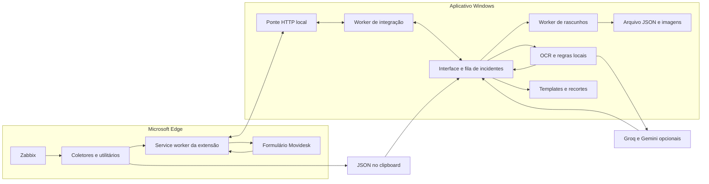
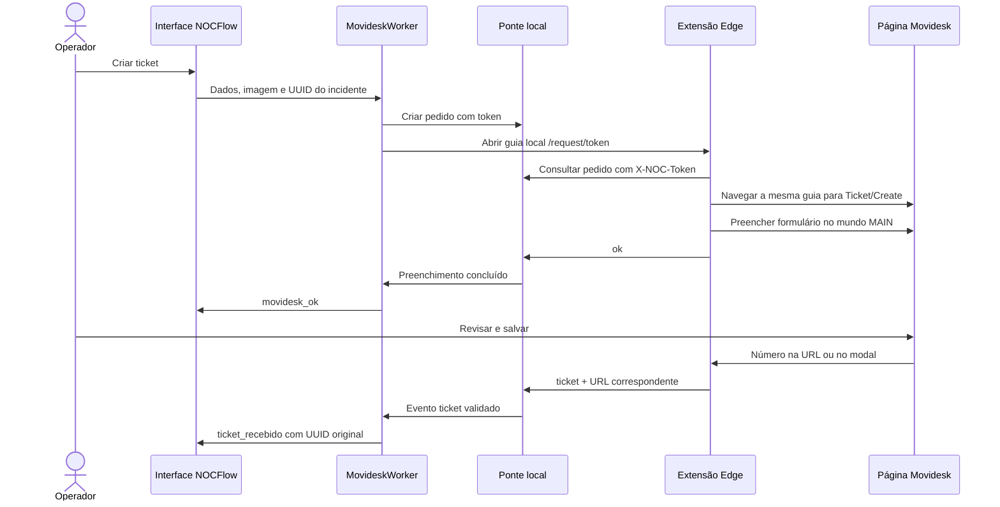

# Arquitetura — NOCFlow

Este documento descreve a implementação atual do aplicativo, os contratos de integração e o processo de manutenção. Para os procedimentos do operador, consulte o [manual de uso](../manual.md). A apresentação do projeto está no [README](../README.md).

## Sumário

- [Visão geral](#visão-geral)
- [Estrutura do repositório](#estrutura-do-repositório)
- [Responsabilidades dos módulos](#responsabilidades-dos-módulos)
- [Inicialização, concorrência e encerramento](#inicialização-concorrência-e-encerramento)
- [Modelo de incidentes](#modelo-de-incidentes)
- [Contrato de importação](#contrato-de-importação)
- [Fluxo Zabbix](#fluxo-zabbix)
- [Ponte HTTP local](#ponte-http-local)
- [Fluxo Movidesk](#fluxo-movidesk)
- [Extensão e userscripts](#extensão-e-userscripts)
- [OCR, IA opcional e cache](#ocr-ia-opcional-e-cache)
- [Comunicados, imagens e clipboard](#comunicados-imagens-e-clipboard)
- [Persistência e recuperação](#persistência-e-recuperação)
- [Configuração e diretórios](#configuração-e-diretórios)
- [Validação e observabilidade](#validação-e-observabilidade)
- [Dependências e empacotamento](#dependências-e-empacotamento)
- [Desenvolvimento e verificação](#desenvolvimento-e-verificação)
- [Adaptação e manutenção](#adaptação-e-manutenção)

## Visão geral

O NOCFlow é um aplicativo desktop Windows com uma extensão Edge Manifest V3. A lógica de domínio, o estado e a persistência ficam no processo Python; a leitura e o preenchimento das páginas ficam no navegador do usuário.



Decisões centrais:

- **Local primeiro:** importação estruturada, parser OCR, fila e comunicados funcionam sem IA.
- **Sessão existente do navegador:** abertura por `msedge.exe --new-tab`; automação por DOM na extensão. Playwright pertence aos testes.
- **Revisão pelo operador:** o preenchimento prepara o ticket; o salvamento permanece uma ação manual no Movidesk.
- **Identidade explícita:** instância/eventid identificam eventos importados; UUID local correlaciona cada incidente com seus pedidos de ticket.
- **Interface orientada a eventos:** workers publicam resultados em filas; widgets são atualizados pela thread Tkinter.
- **Estado local persistido:** um arquivo JSON versionado mantém a fila e as imagens. Tokens de integração são de sessão.

## Estrutura do repositório

```text
app_noc.py                   Entrada do aplicativo e do smoke test empacotado
noc/
  __init__.py                Pacote Python
  interface.py               Interface Tkinter e coordenação dos eventos
  atendimento.py             Etapas, pendências, severidades e próxima ação
  painel_fila.py             Lista recolhível, filtros e atualização incremental
  configuracao.py            Configuração, recursos e diretórios de dados
  incidentes.py              Importação, identidade e fila
  rascunhos.py               Persistência atômica e recuperação
  movidesk.py                Worker da integração Zabbix/Movidesk
  edge_bridge.py             Servidor HTTP local e preparação da extensão
  extracao.py                OCR primeiro e complementação por IA
  extracao_local.py          Parser de texto e cache de extração
  ocr_windows.py             OCR nativo e reconstrução espacial
  comunicados.py             Validação e templates de texto/HTML
  clipboard_windows.py      Publicação de imagem no clipboard nativo
  recortes_email.py          Editor e montagem dos recortes
  tokens_ia.py               Agregação de consumo da sessão
edge_extension/
  manifest.json              Permissões, service worker e content scripts
  background.js              Pedidos, tokens e coordenação de guias
  bridge.js                  Vínculo iniciado pela página local
  coletor.js                 Extração compartilhada do Zabbix
  zabbix.js                  Painel, exportação e imagens do Zabbix
  ticket.js                  Observação do formulário e retorno de tickets
  preencher.js               Preenchimento no contexto da página
  movidesk.js                Utilitários de cópia no Movidesk
  vendor/                    html2canvas e sua licença
tampermonkey/                Userscripts gerados a partir dos coletores
tests/                      Testes unitários, gráficos e de navegador
docs/
  arquitetura.md             Referência técnica atual
  analise-projeto.md          Registro da revisão e reorganização do projeto
README.md                   Apresentação e contexto
manual.md                   Manual operacional detalhado
LEIA-ME-executavel.txt       Orientações rápidas da distribuição
.env.example                Exemplo e referência das opções de configuração
requirements.txt            Dependências de execução
requirements-dev.txt        Dependências de desenvolvimento
requirements-build.txt      Dependências de empacotamento
constraints-build.txt       Restrições da cadeia legada Gemini
pyproject.toml              Configuração do Ruff
gerar_userscripts.py         Geração dos arquivos Tampermonkey
verificar_build.py           Verificação offline dentro do executável
NOC.spec                    Especificação PyInstaller
build.ps1                   Pipeline Windows de distribuição
Build Windows.cmd           Atalho para o pipeline
Abrir configuracoes.cmd     Abertura do .env do executável
```

Diretórios locais como `.venv`, `.venv-build`, `build`, `dist`, `.noc_data` e caches são ignorados pelo Git. `.env` contém a configuração local; `.env.example` é versionado. Perfis de navegador antigos também são ignorados e não são usados pelo fluxo atual da extensão.

## Responsabilidades dos módulos

| Módulo | Elementos centrais | Responsabilidade |
|---|---|---|
| `interface.py` | `NOCFlow`, `main()` | Widgets, seleção do incidente, operação ativa, eventos, revisão de dados, solicitações de salvamento e encerramento. |
| `atendimento.py` | `etapa_incidente()`, `pendencias_incidente()`, `proxima_acao()` | Estado operacional derivado de dados/metadados, sem I/O. |
| `painel_fila.py` | `PainelFila` | Busca, filtros, contadores e Treeview incremental. |
| `configuracao.py` | `Config`, `carregar_config()`, `diretorio_recursos()` | Defaults, leitura do ambiente, preparação do `.env`, limites e localização de recursos/dados. |
| `incidentes.py` | `importar_eventos()`, `identidade_evento()`, `FilaIncidentes` | Contrato de entrada, normalização, deduplicação e snapshots. |
| `rascunhos.py` | `RascunhoWorker` | Carga, migração, serialização de imagens e gravação atômica. |
| `movidesk.py` | `MovideskWorker` | Iniciar pedidos, acompanhar preenchimentos e encaminhar importações/retornos aos incidentes corretos. |
| `edge_bridge.py` | `EdgeBridge`, `Pedido`, `preparar_extensao()` | HTTP autenticado em loopback, expiração de pedidos, cópia dos recursos e abertura do Edge. |
| `extracao.py` | `extrair_dados()`, `consultar_groq()`, `consultar_gemini()` | Ordenar OCR/provedores, completar lacunas e publicar avisos/métricas. |
| `extracao_local.py` | `interpretar_ocr()`, `texto_relevante()`, `CacheExtracao` | Interpretar rótulos, limitar contexto de texto e reutilizar resultados completos. |
| `ocr_windows.py` | `extrair_texto()`, `organizar_palavras()` | Executar WinRT OCR e reconstruir linhas/colunas por coordenadas. |
| `comunicados.py` | `validar_dados()`, `gerar_template()`, `gerar_html()` | Regras por finalidade, assunto de e-mail, templates e descrição do ticket. |
| `clipboard_windows.py` | `copiar_imagem()` | Publicar `CF_DIB` via APIs nativas do Windows. |
| `recortes_email.py` | `EditorRecortes`, `VisualizadorImagem`, `montar_recortes()` | Seleção visual, ampliação sob demanda e montagem local da evidência. |
| `tokens_ia.py` | `ConsumoIA` | Última resposta por API, totais reportados e resumo da sessão. |

A interface depende desses serviços. O worker de integração utiliza a ponte e o gerador de HTML; a ponte valida importações com o módulo de incidentes; a persistência restaura a fila pelo mesmo modelo de domínio. O módulo de extração usa o parser local e o OCR e importa os SDKs dos provedores apenas nas funções que os consultam.

## Inicialização, concorrência e encerramento

### Inicialização

1. `app_noc.py` seleciona a execução normal ou `--verificar-build <relatorio>`.
2. `main()` cria a raiz Tkinter, resolve o diretório de dados e carrega a configuração.
3. `preparar_extensao()` disponibiliza os recursos da extensão no diretório de uso.
4. O logger `noc` é configurado com rotação de arquivo.
5. `NOCFlow` monta a interface, cria o estado inicial e inicia `MovideskWorker` e `RascunhoWorker`.
6. O worker de rascunhos carrega o estado; a interface aplica o evento de carga antes de liberar a operação.

A ponte HTTP é iniciada sob demanda, ao criar o primeiro pedido, não na construção da janela.

### Threads e filas

| Execução | Trabalho | Comunicação |
|---|---|---|
| Thread principal Tkinter | Eventos de widgets e aplicação de resultados | `eventos`, consultada a cada 100 ms com `root.after()`. |
| Worker de rascunhos | Carga/gravações sequenciais | `comandos` com snapshots; eventos de carga, salvamento e erro. |
| Worker Movidesk | Um início de operação por vez, com acompanhamento de vários retornos pendentes | `comandos`, `pendentes` e filas de cada `Pedido`. |
| Threads de operação | Captura, extração e cópia de imagens | Resultados e progresso publicados em `eventos`. |
| Servidor HTTP e handlers | Requisições da extensão | Dicionário de pedidos protegido por lock e fila de eventos por pedido. |

O formato usual dos eventos da interface é `(tipo, identificador, resultado)`. O identificador representa a operação ativa, a revisão de salvamento ou o UUID do incidente, conforme o tipo.

Principais famílias:

- `rascunho_carregado`, `rascunho_salvo`, `rascunho_erro_carga`, `rascunho_erro`.
- `progresso`, `erro`, `captura_ok`, `print_ok`, `imagem_email_ok`.
- `imagem`, `ia_ok`, `ia_provedor`, `ia_consumo`, `extracao_aviso`, `extracao_metricas`.
- `conexao_ok`, `conexao_status`, `pedido_status`, `movidesk_ok`, `retomar_ok`, `abrir_ticket_ok`, `zabbix_importado`, `ticket_recebido`, `integracao_aviso`.

`operacao` guarda sequência e tipo da operação ativa. Resultados de operações são aplicados quando o identificador corresponde ao atual. Importações recebidas durante outra operação aguardam a liberação da interface. Envios externos usam `aplicar_importacao(..., selecionar=False)`, preservando o editor ativo e notificando os demais recebidos. Retornos de ticket usam o UUID original e atualizam somente o campo necessário, mantendo o cursor da edição.

### Encerramento

Ao fechar, a interface solicita o snapshot final e aguarda a confirmação de salvamento. Depois, envia o sentinela de encerramento ao worker de rascunhos e sinaliza o worker de integração, que fecha a ponte e invalida os pedidos. A janela é destruída após o término desses workers.

Se o salvamento falhar, o operador pode continuar aberto ou fechar sem salvar. Threads de extração são daemon; o fechamento não espera uma chamada de IA terminar e resultados tardios não são aplicados à interface. Fechar o aplicativo não fecha o navegador pessoal.

## Modelo de incidentes

`FilaIncidentes` mantém uma lista ordenada `itens` e o identificador `ativo`. A fila começa com um item vazio, reutilizável pela primeira importação.

| Parte do item | Conteúdo |
|---|---|
| `id` | UUID local em formato hexadecimal, gerado na criação. |
| `dados` | Strings dos campos do formulário. |
| `meta` | Origem, identidade externa, métricas, tokens, campos revisados e link Movidesk quando disponível. |
| `imagem` | Objeto PIL em memória ou `None`. |

Campos de evento: `alerta`, `servidor`, `severidade`, `situacao`, `horario`.

Campos adicionais do formulário: `link_zabbix`, `ticket`, `acionamento`, `time_resp`.

### Identidade e atualização

A identidade externa é composta por:

```text
instancia = esquema + autoridade + diretório da instalação Zabbix
identidade = (instancia, eventid)
```

O esquema e a autoridade são normalizados para minúsculas. O diretório é obtido removendo o último segmento do caminho da URL. `eventid` é extraído da query e deve ser numérico ASCII.

Uma recaptura com a mesma identidade atualiza campos disponíveis, preservando valores anteriores quando a nova entrada está vazia. Campos em `campos_revisados` mantêm a edição manual; diferenças recebidas ficam em `meta.atualizacoes`. `resolver_atualizacao()` aplica ou rejeita o valor de um campo. Ticket e encaminhamento não são campos importados do Zabbix. Uma nova imagem substitui a evidência e invalida os recortes anteriores; sem nova imagem, a existente permanece.

Novos eventids ou instâncias geram outros itens. Alerta e servidor não são suficientes para deduplicar ocorrências. Na entrada por OCR, uma mudança textual nesses campos pode criar um novo incidente, mas eventos repetidos do mesmo host/trigger exigem separação manual ou importação estruturada.

`snapshot()` copia os campos e os metadados aninhados; referências às imagens são reutilizadas. O fluxo trata essas imagens como snapshots, substituindo o objeto quando há nova evidência. A restauração valida IDs únicos, o ativo e os tipos básicos, e preenche campos opcionais ausentes.

### Fluxo operacional e lista

`atendimento.py` deriva as etapas **Recebido**, **Em revisão**, **Aguardando ticket**, **Pronto para comunicar** e **Arquivado**. A etapa não é um status remoto do Movidesk. `Próximo` pula arquivados e pedidos ativos, procurando itens sem ticket ou sem primeira cópia de comunicado.

`PainelFila` mantém linhas por UUID, atualiza apenas valores alterados e destaca/oculta linhas conforme busca, severidade, presença de ticket e etapa. Os filtros têm debounce de **180 ms**. A visão da fila ocupa a área central enquanto expandida; recolhê-la devolve espaço ao editor mesmo no tamanho mínimo de 600 × 520.

Arquivar grava `arquivado` e `arquivado_em`. A remoção mantém até 20 itens na memória para desfazer na sessão. Retornos ainda podem atualizar esses itens removidos; eles só reaparecem por ação do operador. Janelas de pendências capturam o UUID original, evitando aplicar uma resolução ao item que tenha sido selecionado depois.

## Contrato de importação

O contrato externo é **JSON versão 1**, com origem `zabbix`. Pode representar um evento avulso ou um lote.

Exemplo de lote:

```json
{
  "versao": 1,
  "origem": "zabbix",
  "eventos": [
    {
      "eventid": "123456",
      "alerta": "CPU usage high",
      "servidor": "host-01",
      "severidade": "High",
      "situacao": "CPU 95%",
      "horario": "2026-10-21 10:42:00",
      "link_zabbix": "https://zabbix.test/tr_events.php?triggerid=1&eventid=123456"
    }
  ]
}
```

No formato avulso, os campos do evento ficam diretamente ao lado de `versao` e `origem`, sem a lista `eventos`.

### Validação e limites

- Entre 1 e 100 eventos por lote.
- Até 2.000.000 bytes no JSON recebido como texto pelo clipboard.
- Campos de evento e link são strings com até 30.000 caracteres; ausentes viram strings vazias.
- O link é obrigatório para a identidade: HTTP/HTTPS, host válido, porta válida, sem credenciais nem espaços/caracteres de controle.
- `eventid` explícito, quando presente, deve corresponder à string numérica do link.
- `imagem_base64` é opcional, textual, com até 2.000.000 caracteres. Os exportadores produzem PNG, bruto em base64 ou em Data URL; a importação decodifica a imagem pelo Pillow e a converte para RGB.
- `aviso` é opcional, textual, com até 1.200 caracteres; fica em `avisos_coleta` para revisão. A aplicação registra `coletado_em`.
- Campos fora do contrato, como ticket e encaminhamento, não são aplicados ao formulário.

O lote inteiro é validado antes de chegar à aplicação na fila. Na ponte, o limite de 2.000.000 bytes vale para o corpo completo do POST de conexão, incluindo o envelope que contém `payload`.

## Fluxo Zabbix

1. **Conexão:** o aplicativo cria um pedido `{"tipo":"conectar"}` com prazo inicial de 15 segundos e abre sua página local no Edge.
2. **Vínculo:** a extensão consulta o pedido e confirma `ok`; o canal passa a durar até 12 horas. Uma nova conexão invalida a anterior no aplicativo.
3. **Coleta:** `coletor.js` lê tabelas por rótulos PT/EN ou pelas colunas da lista de problemas. Valores conflitantes ficam vazios para revisão.
4. **Lotes:** linhas marcadas fornecem links e campos disponíveis. `completar()` busca somente eventos incompletos, com duas tarefas concorrentes e timeout de 8 segundos por detalhe.
5. **Evidência:** em páginas de evento, `zabbix.js` pode renderizar Host/Trigger/Severity e anexar a imagem ao evento. Uma falha na imagem permite continuar com os dados.
6. **Transporte:** a extensão encaminha `importar_zabbix` ao service worker; ele verifica domínio, conexão e origem dos links e envia `importar` à ponte.
7. **Aplicação:** a ponte valida o contrato, o worker publica `zabbix_importado` e a interface aplica o lote quando estiver disponível.

Depois da conexão, `chrome.alarms` agenda um **sinal autenticado por minuto**, somente no loopback. `Pedido.ultimo_sinal` permite publicar `conectado`, `sem_resposta` após 150 segundos, `expirado` ou `desconectado`. Não há consultas periódicas aos sistemas para manter esse indicador.

Na alternativa por clipboard, `zabbix.js` serializa o mesmo contrato. `importar_clipboard()` chama o mesmo validador local. Os userscripts oferecem essa alternativa sem criar uma conexão HTTP com o aplicativo.

O coletor restringe seus links a eventos `tr_events.php` da mesma origem. Isso é mais específico que o validador Python de URL/eventid. A busca do chamado reconhecido é limitada às tabelas de reconhecimento/comentário identificadas; não procura arbitrariamente todos os números da página.

## Ponte HTTP local

`EdgeBridge` utiliza `ThreadingHTTPServer` em **`127.0.0.1:18764`**. Nos testes, a porta pode ser dinâmica com `porta=0`.

Um `Pedido` contém token, dados, prazo monotônico, fila de eventos e sinalização de conexão. O token é gerado com `secrets.token_urlsafe(32)` e tem 43 caracteres no formato utilizado pela extensão.

### Endpoints

| Método e rota | Entrada/autorização | Saída |
|---|---|---|
| `GET /request/{token}` | Host local exato e pedido válido | HTML de conexão, sem os campos privados do incidente. |
| `GET /api/request/{token}` | Host local exato, pedido válido e `X-NOC-Token` correspondente | JSON dos dados do pedido. |
| `POST /api/result/{token}` | Mesmas verificações, `Content-Type: application/json` e tamanho permitido | `{"ok":true}` após encaminhar o evento à fila do pedido. |

Pedidos desconhecidos, expirados ou sem autorização recebem `404`. Eventos inválidos recebem `400`. As comparações de tokens usam `secrets.compare_digest()`.

Limites dos POSTs:

- Canal de conexão/importação: até **2.000.000 bytes**.
- Demais pedidos: até **8.192 bytes**.
- Mensagens de progresso/erro encaminhadas ao worker: até **1.200 caracteres**.
- Número de ticket retornado: até **30 dígitos ASCII**.

### Eventos aceitos

| `tipo` | Campos | Uso |
|---|---|---|
| `progresso` | `mensagem` opcional | Informar andamento. |
| `ok` | `mensagem` e `campos` opcionais | Confirmar conexão, retomada ou preenchimento, conforme o pedido. |
| `erro` | `mensagem` opcional | Encerrar a tentativa com informação de falha. |
| `importar` | `payload` | Importar eventos somente em pedido de conexão Zabbix. |
| `sinal` | sem payload | Atualizar o último contato, somente no canal de conexão Zabbix. |
| `ticket` | `ticket`, `url` | Retornar número somente em pedido associado a uma URL Movidesk. |

Exemplo de retorno:

```json
{
  "tipo": "ticket",
  "ticket": "123",
  "url": "https://empresa.movidesk.com/Ticket/Edit/123"
}
```

A ponte exige correspondência entre esquema/autoridade da URL retornada e do pedido. Também verifica rota e número em `/Ticket/Edit/{id}`, `/Ticket/Create/{id}` ou query `id` dessas rotas, respeitando eventual caminho base da instância.

`campos` aceita apenas `assunto`, `descricao`, `tipo`, `categoria` e `urgencia`; os valores permitidos são `preenchido`, `pendente` e `nao_localizado`. O relatório fica em `meta.preenchimento`, separado do estado de retorno.

Respostas usam `Cache-Control: no-store`, `Referrer-Policy: no-referrer`, `X-Content-Type-Options: nosniff` e uma CSP restrita para a página local. O log HTTP padrão está desabilitado para evitar registrar os tokens presentes nas rotas.

## Fluxo Movidesk



### Pedido e fases

A interface valida os campos necessários e envia `_incidente_id` com os dados e a imagem. O worker gera o HTML e cria um pedido com URL de criação, assunto, alerta, servidor, severidade, categoria, link e timeouts.

No navegador, cada guia é associada à chave `nocflow:{tabId}` em `chrome.storage.session`. As fases são:

1. **`preencher`:** aguardar o formulário, usando `timeout_login` (120 segundos por padrão). O aplicativo também limita a primeira resposta da extensão a 15 segundos.
2. **`salvar`:** após receber `ok`, aguardar o retorno por `timeout_ticket` (8 horas por padrão).
3. **Conclusão:** retorno, erro, expiração ou fechamento invalidam o pedido conforme o lado responsável; o worker remove pedidos expirados da lista de pendentes.

O worker inicia operações de forma serial, mas continua processando os retornos já pendentes enquanto aguarda um novo formulário ou uma conexão.

### Ação contextual e recuperação

- Ticket válido informado: a UI abre `/Ticket/Edit/{ticket}` na instância configurada.
- Pedido vivo do mesmo incidente: o worker deduplica a ação e cria um pedido temporário `{"tipo":"retomar","token_original":"…"}`. A extensão procura a guia pelo token em `chrome.storage.session`, ativa sua janela e fecha apenas a guia local temporária de retomada.
- Erro, expiração, fechamento da guia ou reinício: `pedido_status` informa a interrupção e orienta informar o ticket salvo. A recuperação explícita envia `_novo_pedido`, que invalida o vínculo anterior daquele incidente antes de preparar outro formulário.
- Tokens permanecem apenas em memória e no armazenamento de sessão da extensão. Na carga do rascunho, estados `abrindo`/`aguardando` são convertidos em `interrompido`.

### Preenchimento do formulário

`preencherFormulario()` é injetada por `chrome.scripting.executeScript()` no mundo **MAIN**, para acessar as bibliotecas do site. Seus auxiliares ficam dentro da função, porque ela é serializada para execução na página.

- Aguarda documento pronto, assunto visível e editor disponível.
- Interrompe se o assunto já tiver um conteúdo diferente do pedido.
- Atualiza valores e dispara eventos `input`/`change`.
- Tenta selecionar tipo/ação interna, categoria e urgência conforme os controles encontrados.
- Suporta seletores nativos, Select2 e Kendo. Consultas Select2 são assíncronas, com timeout de 5 segundos.
- Preenche Froala, TinyMCE, Kendo, iframe, textarea ou `contenteditable`, conforme o layout disponível.
- Preserva conteúdo e assinatura existentes e identifica o bloco inserido com `data-nocflow-conteudo="1"` para evitar duplicação.

Categoria, urgência e tipo dependem das opções disponíveis na instância. O preenchimento verifica o valor selecionado após os eventos e retorna o resultado por campo. Conteúdo/título recusados pelo editor geram erro; seleções ausentes ou incompletas são apresentadas como pendências. O relatório descreve a tentativa automática anterior à revisão manual no site.

### Detecção do retorno

`ticket.js` observa mudanças no DOM com debounce de 250 ms, incluindo texto e atributos de classe, estilo e visibilidade. Enquanto aguarda preenchimento, usa fallback de 1 segundo; falhas de comunicação têm tentativas limitadas. `chrome.tabs.onUpdated` cobre mudanças de URL, inclusive History API.

O service worker verifica a origem da guia antes de preencher ou buscar retorno. Se houver número no modal `.protocol-modal .ticket-number` visível, constrói uma URL `/Ticket/Edit/{numero}` na instância do pedido para passar pela mesma validação da ponte.

O evento `ticket_recebido` é aplicado ao UUID original. A seleção atual não é alterada; um ticket diferente já informado fica em `ticket_conflito` para resolução explícita. Os links retornados e copiados pelos utilitários são normalizados para `/Ticket/Edit/{numero}`, inclusive quando o site mantém `/Ticket/Create` e exibe um modal. Remover um incidente não permite que um retorno posterior o recrie automaticamente.

## Extensão e userscripts

O nome exibido pela extensão e pelos painéis é **NOCFlow — Zabbix e Movidesk**.

| Arquivo | Papel |
|---|---|
| `manifest.json` | Manifest V3, permissões `scripting`/`storage`/`alarms`, origens autorizadas e registro dos scripts. |
| `background.js` | Service worker ES module; valida mensagens/remetentes, guarda o estado de sessão, consulta a ponte e coordena as guias. |
| `bridge.js` | Detecta a página local `/request/{token}` e inicia o vínculo com a extensão. |
| `coletor.js` | Funções reutilizáveis de coleta, seleção de linhas, busca de detalhes e localização de chamado reconhecido. |
| `zabbix.js` | Interface do painel, JSON no clipboard, envio e renderização de evidência. |
| `ticket.js` | Observa prontidão/alterações do Movidesk e solicita ao service worker o processamento do pedido. |
| `preencher.js` | Função injetável de automação DOM. |
| `movidesk.js` | Painel de cópia de número, assunto, link e texto de e-mail, com atualização por observação do DOM. |

Origens incluídas: loopback `http://127.0.0.1/*`, `https://*.movidesk.com/*` e as duas instâncias Zabbix listadas no manifesto. As mensagens de runtime exigem remetente da própria extensão, uma guia e, para as operações principais, frame superior. O canal de importação verifica ainda a lista `ZABBIX` e a origem dos links do lote.

`chrome.storage.session` conserva o estado durante a sessão do navegador, incluindo suspensões do service worker. `emAndamento` evita processamento simultâneo da mesma guia durante uma execução do worker. Chamadas HTTP à ponte têm timeout de 5 segundos.

### Fontes compartilhadas

`gerar_userscripts.py` produz:

- `NOCFlow-Zabbix.user.js` = cabeçalho Tampermonkey + `coletor.js` + `zabbix.js`.
- `NOCFlow-Movidesk.user.js` = cabeçalho Tampermonkey + `movidesk.js`.

Os artefatos são versionados para distribuição, mas a edição deve ocorrer nas fontes. Os scripts usam `@grant none` e execução em `document-idle`. O envio direto fica condicionado ao contexto da extensão.

Na versão **2.1.0**, os painéis destacam **Enviar ao NOCFlow**, **Copiar link + imagem** e **Copiar template**. O Zabbix agrupa cópias auxiliares em **Mais opções**.

`html2canvas` 1.4.1 é carregado apenas quando necessário: arquivo empacotado na extensão ou CDN no userscript. Sua licença acompanha `edge_extension/vendor/`.

## OCR, IA opcional e cache

### OCR e parser local

`ocr_windows.py` converte a captura para o formato necessário ao WinRT, ajusta suas dimensões ao limite nativo e executa o reconhecimento com timeout. A escolha de idioma tenta o perfil do usuário e depois Português/Inglês.

As palavras são agrupadas por posição vertical e ordenadas horizontalmente. Distâncias maiores preservam a separação entre colunas. O parser:

- Normaliza rótulos PT/EN e acentuação.
- Reconhece Host, Trigger/Event name, Severity, Operational data e Time.
- Preserva dados operacionais multilinha.
- Interrompe blocos em rótulos de outras áreas, como status, duração e ações.
- Deixa em branco campos com valores conflitantes e horários sem hora válida.

O parser não calcula uma probabilidade de confiança. Campos parciais e avisos são entregues à interface para revisão.

### Coordenação dos provedores

`extrair_dados()` segue a ordem:

1. Calcular a chave de cache e reutilizar um resultado completo, se disponível.
2. Executar OCR e interpretar os campos.
3. Aplicar campos conhecidos/revisados quando a identidade textual reconhecida não mudou.
4. Identificar as lacunas restantes.
5. Se IA estiver permitida e houver texto/chave, consultar Groq somente para as chaves ausentes.
6. Se ainda houver lacunas e Gemini estiver configurado, consultar visão para essas chaves.
7. Publicar dados, avisos, origem, duração e número de chamadas.

Groq recebe texto, nunca a imagem nessa integração. `texto_relevante()` remove a navegação anterior ao primeiro rótulo reconhecido e rejeita contexto acima de 8.000 caracteres. Gemini recebe a imagem. As respostas devem conter strings para as chaves solicitadas, com limite de 30.000 caracteres por valor. Chaves extras não substituem os campos locais.

Há no máximo uma chamada por provedor em cada extração, sem retries automáticos dos SDKs. Falhas opcionais preservam o resultado local e geram avisos. Respostas parciais de Groq podem ser complementadas por Gemini.

### Cache e aplicação das imagens

`CacheExtracao` é LRU, limitado a 20 resultados completos por sessão. A chave SHA-256 inclui pixels, modo/dimensões da imagem, permissão de IA, modelos, tetos de tokens, habilitação dos provedores e campos conhecidos. Resultados incompletos não são guardados. A cache não é usada como identidade de incidente.

**Ler print** captura o clipboard atual; **Reler print guardado** e **Completar com IA** reaproveitam a imagem existente. A nova imagem fica em `imagem_extracao` até a aplicação do resultado, permitindo criar outro incidente sem substituir a evidência anterior. Se a extração falhar, a captura recebida ainda pode ser guardada para revisão.

## Comunicados, imagens e clipboard

`comunicados.py` centraliza a validação por finalidade. Alerta e servidor são obrigatórios; os canais de comunicação exigem também ticket numérico. Links informados são validados antes da ação.

Os templates de WhatsApp, Teams e e-mail são determinísticos e locais. O assunto do e-mail usa `ticket - alerta - servidor`, normalizando espaços e quebras de linha. O HTML do Movidesk escapa os campos textuais e inclui link e PNG em base64 quando há imagem; sem imagem, inclui os campos em uma descrição textual.

`gerar_template()` recebe nome do operador e modelo. A UI oferece **Abertura normal** (padrão, sem saudação) e **Abertura inicial** (com saudação de horário no WhatsApp). Modelos antigos indisponíveis são restaurados como abertura normal; os geradores legados continuam compatíveis com chamadas anteriores. `meta.comunicacao` persiste o modelo e `meta.copias` registra a última cópia bem-sucedida por canal, com horário e modelo; copiar não confirma envio.

No WhatsApp, o nome opcional produz `Nome - Equipe NOC`; sem nome, mantém `Equipe NOC`. Essa preferência é global à instalação do usuário. Após salvar, a UI mostra uma linha compacta com **Editar nome**. A prévia usa rolagem e pode ser ampliada sob demanda.

`EditorRecortes` converte coordenadas da visualização com zoom para pixels da imagem original. `montar_recortes()` valida os limites e empilha Host, Trigger e Severity, sem esticar os trechos. `meta.recortes` persiste somente coordenadas, restauradas e validadas contra a imagem. `meta.evidencia_ticket` guarda a escolha explícita entre original e recorte. Miniaturas são renderizadas quando a aba de evidências está visível; a ampliação só é criada quando solicitada.

Textos são copiados via `pyperclip`. Imagens são publicadas como `CF_DIB` por `ctypes`, com liberação da memória quando há falha e transferência da propriedade ao Windows após sucesso. A operação usa thread de trabalho.

No navegador, `zabbix.js` encontra as linhas pelos rótulos e usa `html2canvas`. A chave do cache de imagem considera URL, conteúdo HTML, cores, fonte, largura e pixel ratio relevantes. **Copiar link + imagem** e **Copiar e-mail + imagem** compartilham a montagem de `text/plain` e `text/html` via Clipboard API. O primeiro inclui um link clicável seguido do PNG em Data URL; o segundo inclui o template seguido da mesma evidência. O destino determina como esses formatos serão colados.

## Persistência e recuperação

O arquivo é `.noc_data/rascunho.json`, atualmente com **versão 2**. Ele contém os dados/imagem do item ativo, o snapshot da fila e o UUID ativo. A imagem é serializada como PNG em base64; ausência de imagem é `null`.

Exemplo reduzido, com campos opcionais omitidos para legibilidade:

```json
{
  "versao": 2,
  "dados": {"alerta": "CPU alta", "servidor": "host-01", "ticket": "123"},
  "imagem": null,
  "fila": {
    "ativo": "a1b2c3d4e5f6478899aabbccddeeff00",
    "itens": [
      {
        "id": "a1b2c3d4e5f6478899aabbccddeeff00",
        "dados": {"alerta": "CPU alta", "servidor": "host-01", "ticket": "123"},
        "meta": {"origem": "DOM", "instancia": "https://zabbix.test", "eventid": "123456"},
        "imagem": null
      }
    ]
  }
}
```

A versão 1, com um único conjunto de dados/imagem, continua legível. Na carga, a interface restaura a fila quando presente; nos arquivos antigos, incorpora os dados ao item inicial. O próximo salvamento escreve a versão 2.

### Estratégia de gravação

- Alterações de formulário agendam salvamento após 750 ms de inatividade; ações relevantes também solicitam gravações diretamente.
- O worker serializa o I/O e mantém apenas o snapshot mais recente entre gravações pendentes.
- Imagens são recodificadas apenas quando o objeto muda, usando um cache de referências do worker.
- O JSON é escrito em `rascunho.tmp`, seguido de `flush()`, `os.fsync()` e substituição do arquivo de destino.
- A revisão acompanha a confirmação de salvamento para que um resultado antigo não sinalize dados novos como salvos.

Em falha de carga, o worker tenta copiar o arquivo para `rascunho-invalido-{timestamp}.json`. Se não conseguir preservar o original, o salvamento fica suspenso na sessão. Uma fila presente, porém inválida, gera erro; não é ignorada como se fosse um rascunho antigo.

O arquivo contém o estado atual da fila, não um histórico de auditoria ou banco compartilhado. O diretório de dados é destinado a uma instância de trabalho; a serialização do worker coordena gravações dentro desse processo.

## Configuração e diretórios

`Config` é uma dataclass imutável. `carregar_config()` prepara o arquivo local a partir de `.env.example`, acrescenta apenas opções ausentes e chama `load_dotenv()`. Variáveis já definidas no ambiente prevalecem sobre os valores do arquivo.

`NOME_OPERADOR` pode ser gravado pela própria aba Comunicar. `salvar_nome_operador()` normaliza espaços e usa `dotenv.set_key()` para atualizar somente essa chave no `.env`, preservando as demais opções. A interface substitui sua instância de `Config` com `dataclasses.replace()` e atualiza a prévia imediatamente; a próxima execução lê o valor salvo.

A referência operacional de todas as variáveis e faixas está no [manual](../manual.md#configurar-o-aplicativo-e-a-ia). Os limites principais são:

- OCR, APIs e formulário: 5–300 segundos.
- Retorno do ticket: 60–86400 segundos.
- Tetos de tokens: 128–32768.
- Booleanos verdadeiros: `true`, `1`, `sim`, `yes`, sem distinção de maiúsculas.

### Recursos e dados

| Tipo | Código-fonte | Executável |
|---|---|---|
| Recursos distribuídos | Raiz do repositório | Diretório `sys._MEIPASS`, normalmente `_internal`. |
| `.env` e `.noc_data` | Raiz do repositório | `%LOCALAPPDATA%\NOCFlow`. |
| Extensão carregada pelo Edge | `edge_extension/` do projeto | Cópia em `%LOCALAPPDATA%\NOCFlow\edge_extension`. |

`diretorio_recursos()` resolve os arquivos empacotados; `diretorio_aplicacao()` resolve o local gravável. A mudança do código Python para `noc/` não muda o diretório dos dados da execução por fonte.

`preparar_extensao()` copia a lista explícita `ARQUIVOS_EXTENSAO` quando origem e destino são diferentes e os bytes mudaram. A atualização dos arquivos exige recarregar a extensão e as páginas no navegador para que os scripts em execução recebam a nova versão.

## Validação e observabilidade

As validações estão distribuídas nas fronteiras correspondentes:

| Fronteira | Verificações |
|---|---|
| Entrada estruturada | Versão, origem, lote, tipos, tamanhos, URL, eventid e imagem. |
| Formulário → ação | Campos obrigatórios por finalidade, ticket numérico e link válido. |
| Extensão → ponte | Host local, token temporário, tipo/tamanho do corpo e compatibilidade do evento com o pedido. |
| Página → service worker | Remetente da extensão, guia/frame, domínio Zabbix e origem Movidesk do pedido. |
| Provedor → extração | JSON e strings das chaves solicitadas; campos locais já resolvidos são preservados. |
| Arquivo → estado | Versão, tipos básicos, IDs únicos, incidente ativo e imagens decodificáveis. |

Configuração e rascunhos são arquivos locais em texto/JSON; as imagens são codificadas, não criptografadas. Cookies de login permanecem no perfil Edge. Chaves de IA são usadas pelos SDKs Python e não integram os pedidos enviados à extensão.

O logger `noc` grava em `.noc_data/noc.log`, com limite de 1.000.000 bytes e dois backups. Erros das operações aparecem no rodapé e no diálogo **Detalhes**. Chamadas opcionais publicam avisos sem encaminhar corpos brutos de erro HTTP dos provedores à interface.

Metadados por incidente incluem:

- `origem`, `instancia`, `eventid` e `link_movidesk`, quando disponíveis.
- `metricas`: origem, duração e chamadas da última extração/importação.
- `tokens_reportados`: total acumulado informado durante as extrações do item.
- `campos_revisados`: campos alterados após uma captura/importação.
- `atualizacoes`, `avisos_coleta`, `coletado_em`: diferenças pendentes, avisos e horário da coleta.
- `em_revisao`, `arquivado`, `arquivado_em`: organização local do atendimento.
- `pedido`, `preenchimento`, `ticket_conflito`: estado/prazo/mensagem do retorno, relatório por campo e divergência de ticket, sem tokens.
- `recortes`, `evidencia_ticket`: coordenadas por campo e imagem escolhida para o ticket.
- `comunicacao`, `copias`: modelo/relato e última cópia por canal.

Campos revisados não significam automaticamente erro do extrator. A proporção local exibida descreve as últimas operações dos itens presentes. Tempos de DOM medem aplicação/importação no aplicativo; tempos de OCR/IA incluem o processamento de extração.

`ConsumoIA` mantém a última resposta e totais por provedor somente na sessão. Cotas Groq vêm dos headers recebidos; Gemini não informa cota restante nessa integração. Valores de consumo não reportados não são estimados.

### Medição local da versão 2.1.0

Medição em Windows, com dados sintéticos, Tkinter e salvamento real em pasta temporária; mediana de 20 filtragens/trocas:

| Cenário | Filtrar | Trocar incidente | Primeiro salvamento | Salvamento com cache de imagens |
|---|---:|---:|---:|---:|
| 100 incidentes, 100 imagens 1200 × 500; JSON de 10,84 MB | 1,1 ms | 7,7 ms | 1.154 ms | 103 ms |
| 1.000 incidentes sem imagens; JSON de 0,39 MB | 13,0 ms | 30,9 ms | 166 ms | 104 ms |

As durações de salvamento incluem a espera pela confirmação na UI; a serialização ocorre no worker. O maior ciclo medido do loop gráfico durante essas gravações foi de 33 ms. Arquivos JSON ainda incluem as imagens e crescem com o volume da fila; os recortes acrescentam apenas coordenadas.

## Dependências e empacotamento

| Arquivo | Finalidade |
|---|---|
| `requirements.txt` | Pillow, pyperclip, python-dotenv, SDKs Groq/Gemini e projeções WinRT condicionadas ao Windows. |
| `requirements-dev.txt` | Reutiliza execução e acrescenta Playwright e Ruff. |
| `requirements-build.txt` | Reutiliza execução, aplica constraints e acrescenta PyInstaller. |
| `constraints-build.txt` | Fixa a cadeia de compatibilidade do SDK Gemini legado. |

Tkinter depende da instalação Python/Tcl-Tk. O build é destinado ao Windows e usa `.venv-build` para isolar as dependências do empacotamento.

### Pipeline de build

```powershell
powershell -NoProfile -ExecutionPolicy Bypass -File .\build.ps1
```

Etapas:

1. Criar/reutilizar `.venv-build` e instalar os requisitos de build.
2. Conferir se o executável de destino está aberto.
3. Regenerar os userscripts.
4. Executar PyInstaller com `NOC.spec`, usando `build` como diretório de trabalho.
5. Copiar README, manual, documentação técnica, orientações rápidas, comando de configuração e userscripts para o pacote.
6. Executar `NOCFlow.exe --verificar-build <relatorio>` e exigir sucesso em até 90 segundos.
7. Preparar os dados locais do usuário do build: copiar configuração/rascunho existentes apenas quando ainda não houver destino.
8. Criar o atalho na Área de Trabalho, salvo quando `-SemAtalho` estiver definido.

Saída padrão: `dist/NOCFlow/NOCFlow.exe`. Para outra pasta:

```powershell
powershell -NoProfile -ExecutionPolicy Bypass -File .\build.ps1 -SemAtalho -PastaSaida dist\homologacao
```

`NOC.spec` usa o formato **onedir**, sem console. Inclui `.env.example`, a extensão, metadados dos SDKs e bibliotecas WinRT. O código de entrada importa os módulos do pacote `noc`; dependências dinâmicas relevantes também são coletadas pelos hooks. Playwright é explicitamente excluído.

Distribua a pasta `NOCFlow` inteira com `_internal`. Dados de uso ficam no diretório externo do usuário e não integram o pacote. Os documentos e os userscripts são arquivos adicionais da distribuição.

## Desenvolvimento e verificação

Execute os comandos na raiz do repositório, em um ambiente Python de desenvolvimento:

```powershell
python -m pip install -r requirements-dev.txt
python -m ruff check .
python -m unittest discover -s tests -v
```

Para incluir os testes de navegador:

```powershell
python -m playwright install chromium --no-shell
$env:NOC_TEST_BROWSER = "1"
python -m unittest discover -s tests -v
```

Os testes de interface precisam de sessão gráfica. O OCR nativo exige Windows e as projeções WinRT instaladas. Os testes de navegador são habilitados pela variável acima e carregam Chromium com fixtures locais; não acessam as instâncias da organização nem APIs pagas.

### Cobertura por arquivo

| Arquivo de teste | Cenários principais |
|---|---|
| `test_atendimento.py` | Expiração, perda/recuperação do sinal e substituição explícita do vínculo de uma guia perdida. |
| `test_edge_bridge.py` | Token, Host, expiração, descarte, importação por canal e validação do retorno. |
| `test_extracao.py` | OCR, provedores simulados, campos conhecidos, falhas, respostas parciais, cache e SDK Groq. |
| `test_fluxo_local.py` | Contrato, identidade, fila, snapshots, migração, parser espacial, coletores DOM e geração dos userscripts. |
| `test_movidesk_local.py` | Extensão real, sessão de navegador, preenchimento, retornos fora de ordem/modal, Select2 e preservação de conteúdo. |
| `test_noc.py` | Interface responsiva, importação durante edição, revisão protegida, ticket contextual, modelos/cópias, filtros, arquivamento, desfazer remoção, recortes após reinício e encerramento. |
| `test_recortes_email.py` | Coordenadas, zoom, seleção, montagem e cópia dos recortes. |
| `test_tokens_ia.py` | Tetos, consumo reportado e configuração. |

`pyproject.toml` habilita no Ruff as regras `E9` e `F`, voltadas a erros sintáticos e problemas como nomes indefinidos/imports sem uso. A formatação completa do projeto não é imposta por essa configuração.

### Verificação do executável

`verificar_build.py` roda dentro do próprio binário e usa diretórios temporários. Confere importação dos SDKs sem chamadas pagas, OCR nativo, parser, fila, recortes, recursos da extensão, ciclo da interface, ponte HTTP autenticada e localização do Microsoft Edge.

O relatório JSON é gravado em `build/verificacao.json`, com status e detalhes de erro quando houver. Essa verificação identifica a instalação do Edge; o exercício real da extensão em navegador está nas fixtures Playwright.

### Homologação operacional

Após mudanças de layout ou integração, exercite no ambiente de uso: um evento de cada Zabbix, uma seleção em lote, uma imagem, um ticket salvo e o retorno ao incidente de origem. Confira categoria, urgência, assinatura e comunicados com os dados revisados. O roteiro do operador está no [manual](../manual.md#atendimento-de-ponta-a-ponta).

## Adaptação e manutenção

### Adicionar domínios

Para outra instância Zabbix, ajuste conjuntamente:

1. `host_permissions` no manifesto.
2. `matches` dos content scripts `coletor.js`/`zabbix.js`.
3. Lista `ZABBIX` em `background.js`.
4. Matches Zabbix em `gerar_userscripts.py`, se distribuir Tampermonkey.

Para um domínio Movidesk personalizado, ajuste `MOVIDESK_URL`, permissões, matches de `ticket.js`/`movidesk.js` e matches do userscript quando aplicável. Os seletores ainda precisam corresponder ao HTML da instância.

Após editar fontes compartilhadas, execute `python gerar_userscripts.py`, valide as fixtures e gere a distribuição. Recarregue a extensão e as páginas. A porta da ponte também é compartilhada entre `noc/edge_bridge.py`, `background.js` e `bridge.js`; mudanças precisam ser coordenadas.

### Evoluir contratos e recursos

- Mudanças de campos envolvem `CAMPOS_EVENTO`/`CAMPOS_FORMULARIO`, importação, interface, templates, OCR, schemas de IA e exportadores.
- Mudanças incompatíveis no JSON externo ou no rascunho devem considerar suas versões e a migração dos dados existentes.
- Novos arquivos da extensão precisam constar nos pontos de carregamento e em `ARQUIVOS_EXTENSAO`, que controla a cópia para o diretório do usuário.
- Alterações nos coletores devem ser feitas em `edge_extension/`, seguidas de regeneração dos artefatos Tampermonkey.
- Os defaults de configuração estão em `Config`/`carregar_config()` e `.env.example`; a adição automática ao arquivo local usa o exemplo distribuído.
- Mudanças na documentação distribuída devem atualizar as cópias previstas em `build.ps1` e as referências de `LEIA-ME-executavel.txt`.

### Pontos de evolução conhecidos

- O SDK `google-generativeai` utilizado é legado e informa encerramento de suporte. A migração para `google-genai` envolve schemas, erros, consumo e hooks; a integração está concentrada em `noc/extracao.py`.
- As constraints fixam a cadeia Gemini, mas o ambiente completo de release ainda aceita faixas nas demais dependências.
- A interface concentra construção visual e despacho de eventos, enquanto persistência e serviços já estão isolados. A separação futura das abas pode ocorrer sem alterar seus contratos.
- A fila representa o estado operacional local. Tokens, caches de extração, remoções desfeitas e painel de cotas são de sessão; recortes, modelos e estado do atendimento são persistidos.

O [registro da análise e reorganização](analise-projeto.md) documenta o diagnóstico, as correções e as medições daquela revisão. Este arquivo é a referência da arquitetura atual.
